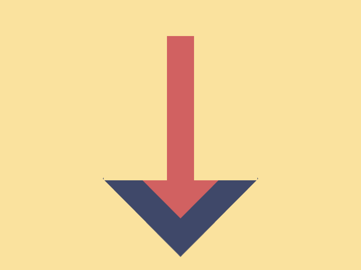
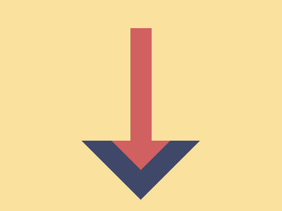

# Daily Target — Oct 11, 2026

Challenge: <https://cssbattle.dev/play/Fq5TIqZggu5mqVHldcND>

## Result

<table>
	<tr>
		<th width="50%">User Submission</th>
		<th width="50%">Target</th>
	</tr>
	<tr>
		<td width="50%" align="center">
			
		</td>
		<td width="50%" align="center">
			
		</td>
	</tr>
</table>

## Code

```html
<style>&{corner-shape:bevel;border-radius:50%;border:32q solid#3F4869;box-shadow:0 0 0 9in}*{color:FAE29E;margin:111 114 15;background:#D16161;*{border-inline:70px solid;margin:-101-29 55
```
