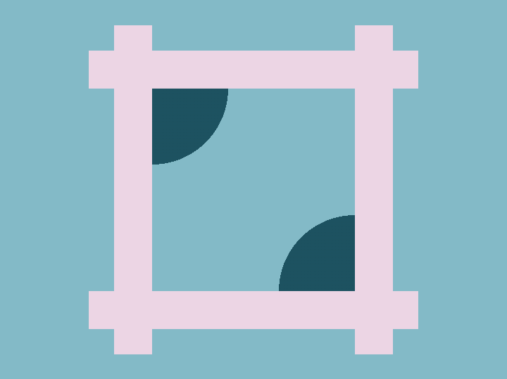

# Daily Target — Oct 12, 2026

Challenge: <https://cssbattle.dev/play/GtfVbDS2vn8CI4nnV4Yl>

## Result

<table>
	<tr>
		<th width="50%">User Submission</th>
		<th width="50%">Target</th>
	</tr>
	<tr>
		<td width="50%" align="center">
			
		</td>
		<td width="50%" align="center">
			
		</td>
	</tr>
</table>

## Code

```html
<style>
  * {
    margin:20 90;
    background: 
      radial-gradient(
        1q at 0 0,#1D5260 60px,#0000 0
      )no-repeat 0 50px #84B9C7;
    border-inline:30px solid #ECD5E4;
    *{
background: 
      radial-gradient(
        1q at 100% 0,#1D5260 60px,#0000 0
      )no-repeat 0 50px
      ;
      margin:0 -30;
      rotate:90deg;
```
