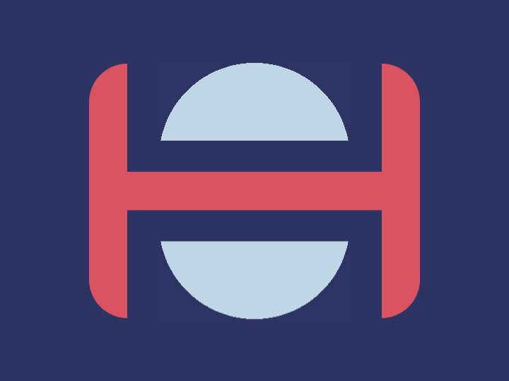

# Daily Target — Oct 18, 2026

Challenge: <https://cssbattle.dev/play/W7SWtIqYNFiLhipGj6bj>

## Result

<table>
	<tr>
		<th width="50%">User Submission</th>
		<th width="50%">Target</th>
	</tr>
	<tr>
		<td width="50%" align="center">
			
		</td>
		<td width="50%" align="center">
			
		</td>
	</tr>
</table>

## Code

```html
<style>&{outline:9in solid#2d3464;margin:50 70;background:#d95362;border-radius:32q;*{background:radial-gradient(1q,#c0d6e7 75px,#2d3464)50%0/100%50vh repeat-x#2D3464;border:26q solid#2D3464;margin:-25 30 115;-webkit-box-reflect:below 32q
```
