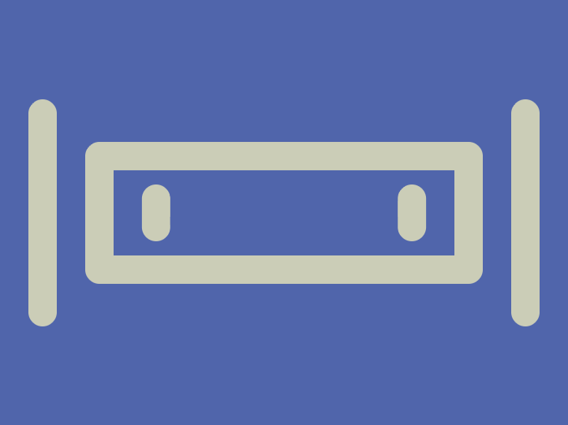
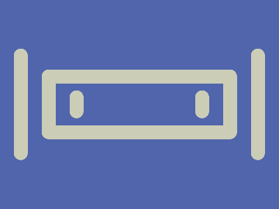

# Daily Target — Oct 24, 2026

Challenge: <https://cssbattle.dev/play/aX2gsaI5uRiBiKxXgfOp>

## Result

<table>
	<tr>
		<th width="50%">User Submission</th>
		<th width="50%">Target</th>
	</tr>
	<tr>
		<td width="50%" align="center">
			
		</td>
		<td width="50%" align="center">
			
		</td>
	</tr>
</table>

## Code

```html
<style>&{color:CBCDB7;border:5vw solid;background:#5065ab}*{margin:100 60;border-radius:10px;*{margin:-50 110;box-shadow:-21.25ch 0,21.25ch 0;*{margin:60 0 0;padding:20 10;font:53%a
```
