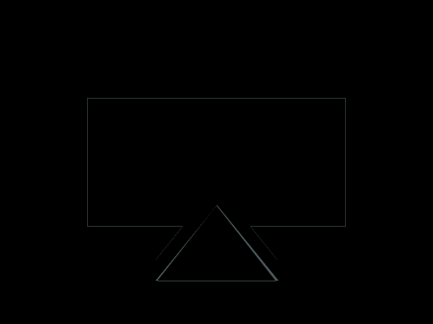

# Daily Target — Oct 25, 2026

Challenge: <https://cssbattle.dev/play/Y5ONBPIczkMuJt7MUtxP>

## Result

<table>
	<tr>
		<th width="50%">User Submission</th>
		<th width="50%">Target</th>
	</tr>
	<tr>
		<td width="50%" align="center">
			
		</td>
		<td width="50%" align="center">
			
		</td>
	</tr>
</table>

## Code

```html
<style>
  & {
    border:31px solid#36443B;
    margin:60 50;
    background: #809E97;
    *{
      background:#809E97;
      margin:80 36 -65;
      clip-path:polygon(50% 0,100% 100%,0 100%);
      *{
        margin:19 27 0;
        padding:35 57;
        background:#36443B;
      }
```
