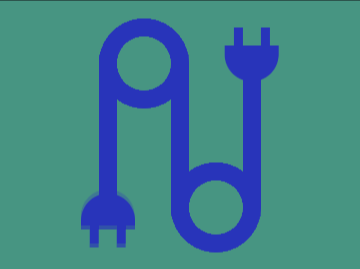

# Daily Target — Oct 26, 2026

Challenge: <https://cssbattle.dev/play/z0yxKNnAycnbUfSMzhrV>

## Result

<table>
	<tr>
		<th width="50%">User Submission</th>
		<th width="50%">Target</th>
	</tr>
	<tr>
		<td width="50%" align="center">
			
		</td>
		<td width="50%" align="center">
			
		</td>
	</tr>
</table>

## Code

```html
<style>&{margin:20 110;--b:radial-gradient(1Q,#0000 30px,#2834ba 0 50px,#0000)no-repeat;background:var(--b)-5ch -5pc,var(--b)5ch 5pc#479582;>*{margin:40 80;color:#2834ba;box-shadow:inset 1in 0,-5pc 0,5pc 0;img{background:conic-gradient(at 10px 5vw,#479582 25%,#2834BA 0)11q/30px;border-radius:0 0 1in 1in;padding:30;translate:var(--t,63q -30px);+*{scale:-1;--t:-25vw 5lh
```
