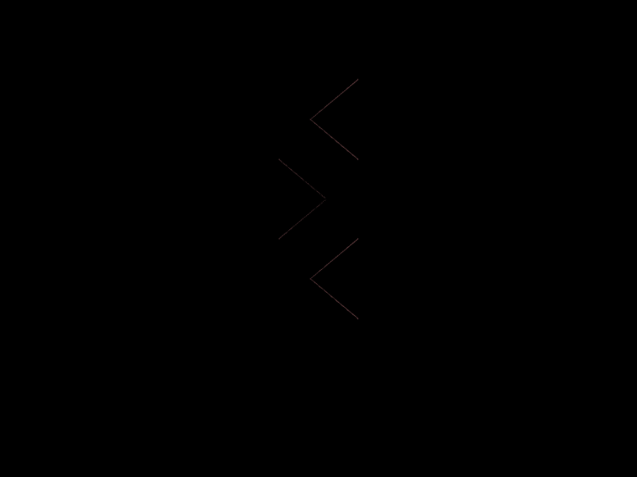
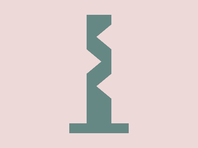

# Daily Target — Nov 3, 2026

Challenge: <https://cssbattle.dev/play/uUqcv42UqXa4qqYW40dd>

## Result

<table>
	<tr>
		<th width="50%">User Submission</th>
		<th width="50%">Target</th>
	</tr>
	<tr>
		<td width="50%" align="center">
			
		</td>
		<td width="50%" align="center">
			
		</td>
	</tr>
</table>

## Code

```html
<style>/* first try */
& {
  margin: 30 35%;
  outline:9in solid#EED9D9;
  background: #668884;
  border-bottom:20px solid #668884;
  box-shadow:inset 35px 0px #EED9D9,inset -35px 0px #EED9D9;
  padding:69 55 99 3;
  * {
    background: #EED9D9;
    margin: 0;
      corner-shape:bevel;
      border-radius:50%;
      box-shadow:52px -50px #EED9D9,52px 50px #EED9D9;
```
