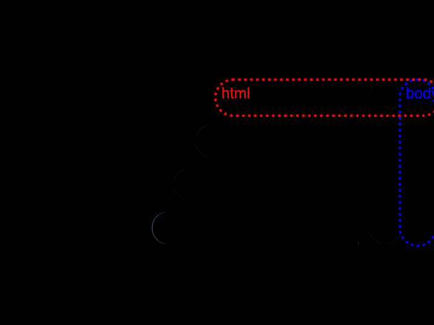

# Daily Target — Nov 10, 2026

Challenge: <https://cssbattle.dev/play/im5bpfWBaCfsHz3ynGXj>

## Result

<table>
	<tr>
		<th width="50%">User Submission</th>
		<th width="50%">Target</th>
	</tr>
	<tr>
		<td width="50%" align="center">
			
		</td>
		<td width="50%" align="center">
			
		</td>
	</tr>
</table>

## Code

```html
<style>
  * {
    margin:75 -5 195 200;
    border-radius:1in;
    background:#A98955;
    color:373737;
    box-shadow:var(--a,
      inset 0 3in,
      -63q 30vw#FFF,
      -5ch 5pc,
      -5vw 5ch#FFF);
    *{
      margin:0 5 -120 170;
      --a:-30px 0,0 0 0 5ch #A98955;
    }
```
