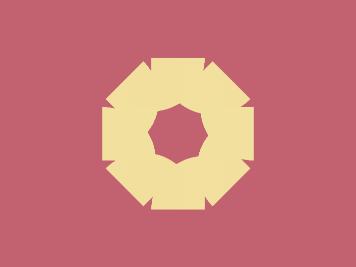
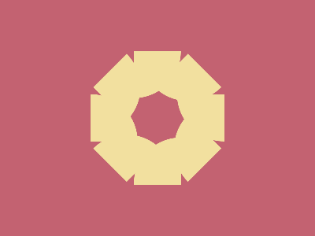

# Daily Target — Nov 16, 2026

Challenge: <https://cssbattle.dev/play/jnMuDO3lQ6zvVd2hlovm>

## Result

<table>
	<tr>
		<th width="50%">User Submission</th>
		<th width="50%">Target</th>
	</tr>
	<tr>
		<td width="50%" align="center">
			
		</td>
		<td width="50%" align="center">
			
		</td>
	</tr>
</table>

## Code

```html
<a><b><i><a><b><i><p><u><style>&{background:#c36271;*{margin:65 170;rotate:45deg;*{margin:0;position:fixed;width:60;height:170}background:radial-gradient(1Q at 0 0,#f2e09f 60px,#0000
```
