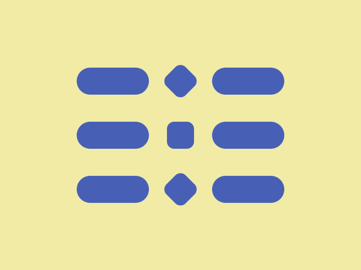
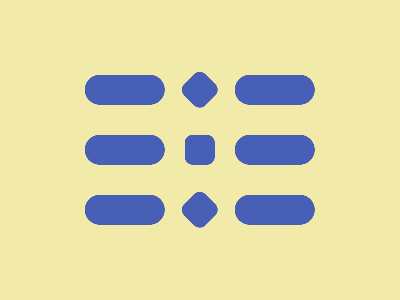

# Daily Target — Nov 18, 2026

Challenge: <https://cssbattle.dev/play/OuZGRWZ169z3th35sN48>

## Result

<table>
	<tr>
		<th width="50%">User Submission</th>
		<th width="50%">Target</th>
	</tr>
	<tr>
		<td width="50%" align="center">
			
		</td>
		<td width="50%" align="center">
			
		</td>
	</tr>
</table>

## Code

```html
<style>
  & {
    background: #DC26;margin:67 47;
    img{
      padding:15 40;
      background:#4760B6;
      border-radius:1em;
      margin:0 -10 30 30;
      &[s]{
        padding:15;
        font:50%a;
        &[r]{
          rotate:45deg;
        }
      }
```
